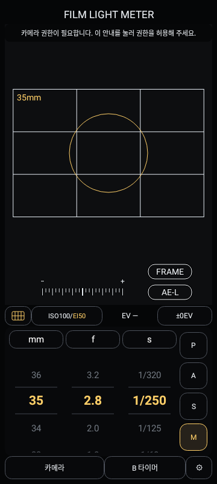
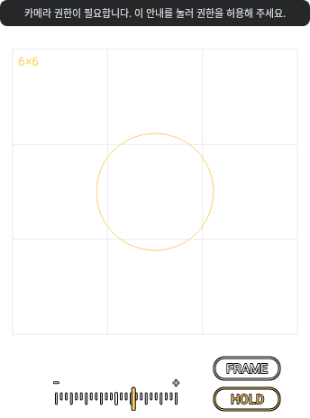

# FilmLightMeter

필름카메라 촬영에 사용할 노출 조합을 확인하는 Android 노출계 앱입니다. 스마트폰 카메라의 미리보기와 노출 메타데이터를 참고해 ISO/EI, 조리개, 셔터 시간과 프레임을 조정합니다. 확인한 값은 필름카메라에 직접 설정합니다.

**기준 앱: 0.2.7 · Android 8.0 이상 · 커뮤니티 테스트 단계**

이 폴더는 앱 소개와 **실제 프로젝트에서 선별한 일부 원본 코드**를 공유하는 자료입니다. 전체 소스나 Android 빌드 프로젝트가 아니며, 오픈소스 라이선스를 적용한 저장소도 아닙니다. 기존 개발 저장소의 Git 이력은 포함하지 않았습니다.

[사용 예제](examples/README.md) · [전체 구조](docs/ARCHITECTURE.md) · [공개 범위](docs/SOURCE-SCOPE.md) · [데이터 처리](docs/PRIVACY.md) · [라이브러리](docs/DEPENDENCIES.md) · [업데이트](UPDATES.md)

## 주요 기능

- P/A/S/M 노출 모드, mm·f·s 스크롤 다이얼과 기본값 초기화. 기본 기준은 35mm·f/2.8·1/250초입니다.
- ±2EV 범위의 1/3스톱 노출보정과 노출 게이지. 노출 부족은 왼쪽 −, 과다는 오른쪽 +로 표시합니다.
- ISO와 EI 설정. 별도 EI는 `ISO100/EI50`처럼 표시하고 EI 부분만 노란색으로 구분합니다. ISO를 바꾸면 EI는 새 ISO를 따릅니다.
- AE-L로 앱의 EV 기준값 고정, HOLD로 미리보기 화면 고정.
- 측광모드 아이콘 전환과 포인트 드래그·탭 잠금, 프레임 가이드와 3분할선.
- 35mm·6×6·6×7·HALF·6×8·6×9·4×5 프레임과 표시할 프레임 선택.
- 바디와 렌즈를 함께 저장하는 번호별 프로파일. 렌즈 적용 시 mm 초기화 기준은 해당 렌즈의 최대광각입니다.
- 1/16000초까지의 일반 셔터 선택, 8초 초과 시간을 위한 B 칸과 별도의 B 타이머. 프로파일 적용 시 장비 범위를 따릅니다.
- 이전 설정·모드 기억과 한국어·영어·일본어 UI.

측광모드별 실제 분석과 정확도 검증 상태는 아래의 구현 범위를 확인하세요.

## 화면 예시

아래 이미지는 **0.2.7 소스를 Android API 33 모의 환경에서 렌더링한 화면**입니다. 실기기 촬영 화면이나 측광 정확도 검증 사진이 아닙니다. 카메라 권한 안내와 비어 있는 미리보기가 포함됩니다. HOLD 화면의 흰 배경은 테스트용 이미지입니다.

| ISO/EI 설정 표시 | HOLD 화면의 버튼 표시 |
| --- | --- |
|  |  |

## 설치와 업데이트

공개 자료의 기준 주소는 [FilmLightMeter-public](https://github.com/strix3848/FilmLightMeter-public)입니다.

- [공개 자료 ZIP 다운로드](https://github.com/strix3848/FilmLightMeter-public/archive/refs/heads/main.zip): 설명·이미지·부분 코드만 포함합니다. 설치 파일이나 전체 앱 소스가 아닙니다.
- [앱 다운로드 · Releases](https://github.com/strix3848/FilmLightMeter-public/releases): 운영자가 서명된 릴리스 APK를 게시하면 해당 버전의 `FilmLightMeter-<버전>.apk` 자산을 받습니다. **이번 공개 자료 업로드에는 APK나 Release 게시가 포함되지 않습니다.** APK가 아직 없으면 운영자의 커뮤니티 테스트 게시글에서 안내하는 파일을 사용하세요.

비공개 개발 저장소와 개발용 Actions 아티팩트는 공개 다운로드 경로로 사용하지 않습니다.

1. Android 8.0 이상 기기에서 운영자가 배포한 `FilmLightMeter-<버전>.apk`를 받습니다.
2. 필요한 경우 Android 설정에서 해당 다운로드 앱의 ‘알 수 없는 앱 설치’를 허용한 뒤 설치합니다.
3. 처음 실행할 때 카메라 권한을 허용합니다. 거부했다면 앱의 카메라 안내를 눌러 권한을 다시 설정할 수 있습니다.
4. 후속 버전은 동일한 공식 서명키와 더 큰 내부 버전 코드를 사용하는 APK로 업데이트합니다. 다른 서명으로 설치했던 앱에서 전환할 때는 재설치가 필요할 수 있으며, 제거하면 저장된 설정도 삭제됩니다.

현재 앱 정보와 공개 자료 변경은 [UPDATES.md](UPDATES.md)에서 확인합니다. 공개 자료의 버전과 설치 APK의 버전은 구분합니다.

## 기본 사용법

1. ISO 버튼에서 필름 ISO를 정합니다. EI를 따로 지정하지 않으면 ISO를 사용합니다.
2. 필요하면 카메라 메뉴의 프로파일 관리에서 바디와 렌즈를 함께 등록하고 프로파일을 선택합니다.
3. mm 다이얼로 프레임을 맞추고 P/A/S/M 중 원하는 모드를 선택합니다.

| 모드 | 사용자가 조정 | 앱이 제안 |
| --- | --- | --- |
| P | 화각 | 조리개·셔터 조합 |
| A | 화각·조리개 | 셔터 시간 |
| S | 화각·셔터 시간 | 조리개 |
| M | 화각·조리개·셔터 시간 | 게이지로 노출 차이 확인 |

4. ±EV 버튼을 열어 노출보정 다이얼을 스크롤합니다. 0이 아닌 보정값은 노란색으로 표시합니다.
5. AE-L 버튼은 기본적으로 노출고정 → HOLD → 해제로 전환합니다. 설정에서 HOLD 단계를 끌 수 있습니다.
6. FRAME 버튼은 선택한 프레임만 순환합니다. 바디 프로파일이 적용되면 그 바디의 프레임으로 고정됩니다.
7. 포인트를 드래그해 옮기고 탭으로 위치를 잠그거나 해제합니다. 이는 현재 범위 표시와 포인트 UI 조작입니다.
8. 장노출은 B 칸과 B 타이머를 참고합니다. 필름카메라의 셔터 개폐는 직접 수행하며, 타이머 사용 중에는 앱 화면을 켜 두세요.

직접 조정 가능한 다이얼을 움직인 뒤 mm·f·s 제목의 초기화 버튼을 누르면 기본값으로 돌아갑니다. P/A/S의 자동 제어 항목은 노란색 AUTO 표시로 구분합니다. 프로파일 적용 시 기본값은 장비 범위 안에서 선택됩니다.

## 권한과 개인정보 처리

0.2.7의 앱 소스와 릴리스 Manifest를 확인한 내용입니다.

| 권한 | 용도 |
| --- | --- |
| CAMERA | 미리보기와 Camera2 노출 메타데이터 읽기 |
| VIBRATE | B 타이머 종료 진동 |

- 앱은 인터넷·저장소·마이크·위치 권한을 요청하지 않습니다. 앱 코드에서 영상 파일 저장·전송, 외부 API 호출, 광고·분석 SDK를 확인하지 못했습니다.
- HOLD 이미지는 메모리에 두며, 백그라운드 전환·화면 꺼짐·권한 상실 시 해제합니다.
- 설정, 프로파일 이름과 메모, 감도, 다이얼 값, 언어 등은 앱 내부 SharedPreferences에 저장합니다. 별도의 데이터 암호화 기능은 확인되지 않았으며 Android의 앱 데이터 접근 제한에 의존합니다.
- 앱의 클라우드/기기 전송 백업 제외와 평문 통신 비활성화를 설정했습니다. 외부 공개 구성요소는 실행에 필요한 런처 Activity 하나입니다.
- 이 설명은 앱 코드의 범위입니다. Android 제조사 서비스, 설치 경로, GitHub와 커뮤니티 사이트의 접속정보 처리는 각 플랫폼의 동작과 정책을 따릅니다.

확인 근거와 삭제 방법은 [데이터 처리 설명](docs/PRIVACY.md)에 정리했습니다.

## 구현 상태와 한계

| 구분 | 상태 |
| --- | --- |
| P/A/S/M 제안, ISO/EI, 보정 UI, 다이얼, AE-L/HOLD, 프로파일, 저장·복원, 언어 | 구현되어 있으며 모의 환경 회귀 검사 수행 |
| 프레임 선택, 측광모드 아이콘, 포인트 이동·잠금 | UI와 상태 조작 구현 |
| 평균·중앙·스팟별 별도 장면 분석, 포인트 위치에 따른 Camera2 측광 영역 지정 | **미구현**. 아이콘·원 표시를 실제 분석 범위로 해석하면 안 됨 |
| 측광 정확도 | Camera2 자동노출 메타데이터 기반 참고값. 장면 휘도 교정과 기준 노출계 비교 검증 미완료 |
| P 모드 제안과 화각 가이드 | 단순 제안 규칙·근사 화각. 기기별 렌즈/줌 동작과 프레임 일치 검증 필요 |
| 화면 꺼짐 후 복구 | 0.2.7에서 재연결 시도 누락 경로 수정 및 모의 검사. 실기기 영상 복구 검증 미실시 |
| B 타이머 | 구현. 백그라운드나 절전 상태의 정확한 종료 알림 보장 없음 |

현재 앱 검증 기록은 디버그·릴리스 각각 단위 테스트 64개와 API 33 모의 검사 35개 통과입니다. 이는 0.2.7 개발 단계의 로컬 검사 결과이며 실기기 설치·업데이트·화면 잠금·카메라 동작이나 측광 정확도의 검증을 대신하지 않습니다. 이번 공개 자료 준비 과정에서 앱 기능을 추가하거나 버전을 변경하지 않았습니다.

## 공개 범위와 빌드 불가 이유

공개 원본 코드는 ISO/EI 연동 상태와 표시 프레임 순환을 다루는 Java 파일 **두 개**입니다. [원본 출처와 누락 범위](docs/SOURCE-SCOPE.md)에 정확한 파일과 변경 여부를 명시했습니다. 예제 실행기는 이 자료를 위해 별도로 작성한 호출 도구이며, 비공개 구현을 대체하는 가짜 코드가 아닙니다.

실제 측광·보정 처리, 카메라 제어·기기별 대응, 노출 조합 제안, 전체 화면과 다이얼, 상태 저장 통합, 앱 리소스, Android Manifest, Android 빌드·CI 설정 및 서명 자료는 제공하지 않습니다. 앱 시작점과 핵심 구현·리소스·빌드 프로젝트가 없으므로 **이 자료만으로 FilmLightMeter APK를 빌드하거나 동일 앱을 배포할 수 없습니다.** 예제 컴파일은 Java 클래스와 콘솔 예제만 만듭니다.

이 분리는 공개 자료만으로 앱을 그대로 빌드하는 것을 막는 구성입니다. 화면과 설명을 참고한 별도 앱의 재구현이나, 별도로 배포된 APK의 분석까지 기술적으로 차단하는 기능은 아닙니다. 공식 서명키를 제공하지 않는 것과 앱 구현의 복제 가능성은 별개입니다.

## 버그 제보와 이용 조건

피드백은 운영자의 커뮤니티 배포 게시글 댓글로 받습니다. 필요한 경우 공개 저장소의 [Issues](https://github.com/strix3848/FilmLightMeter-public/issues)에서도 [제보 양식](.github/ISSUE_TEMPLATE/bug_report.md)을 참고할 수 있습니다. 자동 전송 기능은 없으며 [제보 안내](docs/FEEDBACK.md)를 참고하세요.

**이용 조건은 아직 확정하지 않았습니다.** MIT·Apache 등 라이선스를 붙이지 않았으며, 공개 열람이 앱·소스·이미지의 재사용·재배포를 포괄적으로 허락한다는 뜻은 아닙니다. GitHub에 공개하는 경우 플랫폼 약관의 열람·복제·Fork 범위도 적용됩니다. [이용 범위 정리와 조건 제안](TERMS-PROPOSAL.md)은 검토용 초안이며 현재 적용된 라이선스가 아닙니다.

[공개 자료 검사 결과](PUBLICATION-CHECK.md) · [파일 무결성 목록](FILES.sha256)
