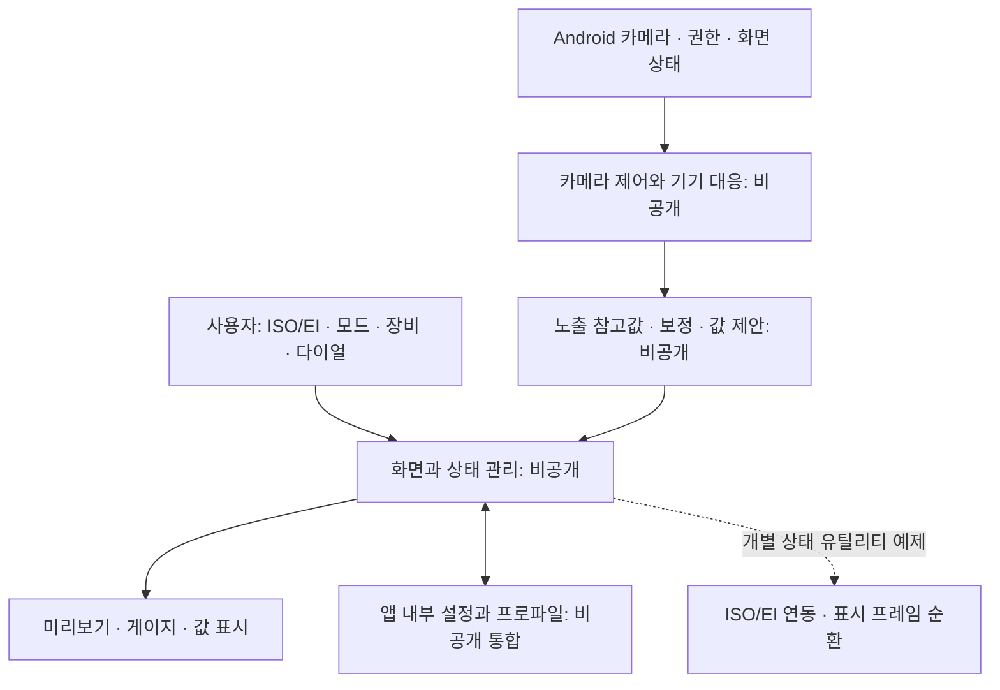

# 전체 구조 설명

이 문서는 0.2.7 앱을 검토해 작성한 구조 설명입니다. 비공개 구현의 코드, 계산식, 기기 선택 규칙이나 복구 타이밍을 재현하는 명세는 포함하지 않습니다.

| 영역 | 역할 | 공개 방식 |
| --- | --- | --- |
| 입력/UI | 모드·다이얼·보정·장비 설정과 결과 표시 | 설명·렌더링 이미지 |
| 카메라 | 카메라 자원 수명 관리와 미리보기, 기기별 처리 | 개념만 설명, 구현 제외 |
| 노출 처리 | 카메라 메타데이터에서 참고값을 만들고 보정·노출 조합 제안 | 역할만 설명, 구현 제외 |
| 화면 가이드 | 프레임·3분할·포인트·게이지 | 기능 설명, 프레임 순환 유틸리티만 공개 |
| 저장 | 설정·프로파일의 내부 저장과 복원 | 저장 항목과 처리 방식만 설명 |
| B 타이머 | 장노출 시간 참고와 종료음·진동 | 사용자 기능만 설명 |

공개 예제의 ISO/EI 상태 클래스는 감도 선택의 연동 규칙만 다룹니다. 감도를 노출 계산에 반영하는 처리나 카메라 감도 제어 코드는 포함하지 않습니다. 프레임 클래스도 표시 가능한 항목을 순환하는 규칙만 다루며 실제 미리보기 변환이나 카메라 화각 대응을 제공하지 않습니다.

Android 앱에 사용된 외부 런타임 라이브러리는 없습니다. 앱은 Java와 Android 플랫폼 API를 사용합니다. 자세한 의존성 구분은 [라이브러리 설명](DEPENDENCIES.md)을 참고하세요.
